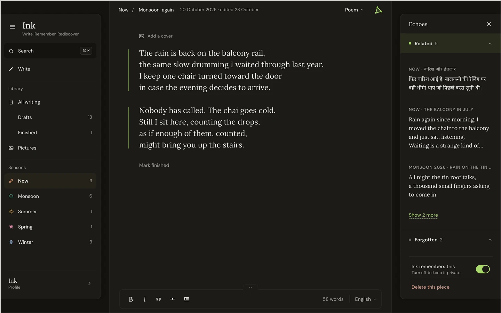
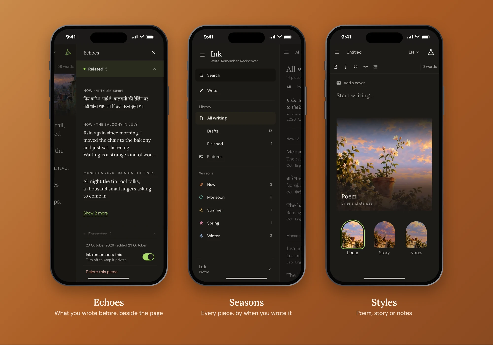

<p align="center">
  
</p>

<p align="center">
  <a href="https://withink.app">Website</a> ·
  <a href="https://withink.app/#join">Join the waitlist</a> ·
  <a href="https://withink.app/privacy">Privacy</a>
</p>

# Ink

<p align="center">
  
</p>

[Ink](https://withink.app) is a private place to write that remembers. It shows you the old poem that echoes today's line, the piece you forgot you started, and the idea you keep returning to. It never touches your sentences. It only gives your own words back at the right moment.

<p align="center">
  
</p>

## Why another place to write

Writing piles up in notes apps, drafts, chat threads and phone memos. A line arrives, you save it somewhere, and months later you cannot find it, or you forget you ever wrote it.

Most writing apps only store your words, and many now offer to rewrite them. Ink never rewrites. It remembers: it reads what you have already written and quietly brings the right piece back beside what you write now.

## What you get

- **Echoes.** Older pieces close to the one you are writing, beside the page.
- **Search.** Find a piece by the words you remember, typos and all, or by what it was about.
- **Noticed.** Now and then, a quiet note when an old line comes back.
- **A calm page.** Poems, stories and notes, in any language. It saves on your device first.
- **Yours alone.** Keep any piece out of Ink's memory, or delete it. No streaks, no dashboards, no critique.
- **An open model.** Ink's memory runs on [BGE-M3](https://huggingface.co/BAAI/bge-m3), an open model on Ink's own server. Your writing is never sent to an outside service.
- **Open source.** MIT licensed. Read the code, or run Ink yourself.

## How it works

1. **You write.** The page saves as you go.
2. **Ink remembers.** Once a piece has been quiet for a while, a private service turns it into a meaning vector with an open model ([BGE-M3](https://huggingface.co/BAAI/bge-m3)). Nothing runs on a keystroke.
3. **Ink connects.** Related writing and search compare vectors inside your own pieces and nobody else's. Only open models are used. The settings behind search are in [docs/search.md](./docs/search.md).

## Join the waitlist

Ink is opening to its first writers soon. Leave your address and Ink writes to you when hosted plans open.

**[Join the waitlist at withink.app](https://withink.app/#join)**

---

## For developers

### Repository layout

| Path | What it holds |
| --- | --- |
| `apps/web` | The writing app (React, Vite, TypeScript) |
| `apps/api` | The API (Fastify, Zod, PostgreSQL through Supabase), migrations, and the Bruno privacy checks |
| `apps/embedder` | The embedder service (Python), see its [README](./apps/embedder/README.md) |
| `packages/schemas` | Zod schemas shared by the web app and the API |
| `docs` | The [setup guide](./docs/development.md), and notes on [search](./docs/search.md) and [sign-in emails](./docs/auth-setup.md) |

It is a pnpm and Turborepo monorepo.

### Run it locally

You need Node 20 or newer, pnpm, and a [Supabase](https://supabase.com) project or a local one.

```bash
pnpm install
cp .env.example .env
pnpm db:migrate
pnpm --filter @ink/api dev
pnpm --filter @ink/web dev
```

Fill in `.env` before `pnpm db:migrate`, and start the API and the web app in two terminals. The web app opens at `http://localhost:5173`.

The full steps are in [docs/development.md](./docs/development.md): where each `.env` value comes from, a local Supabase, the sign-in settings, the optional embedder, and opening Ink on a phone.

### Checks

```bash
pnpm typecheck
pnpm test
```

Every pull request runs these and more in CI. A job starts a local Supabase and the real API, then runs the database tests, the Bruno collection in `apps/api/bruno` and the browser tests. Bruno signs in as two different writers and checks that neither can read or change the other's data, and that expired, broken and signed-out tokens are refused. The embedder's own tests run with the real model, and a hygiene check reads every file and commit.

## Status

Ink is in early development. It is not open to outside contributions (see [CONTRIBUTING.md](./CONTRIBUTING.md)); to report a security issue, do it privately instead of opening a public issue.

## Licence

MIT. See [LICENSE.md](./LICENSE.md).
